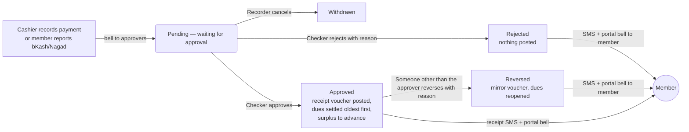
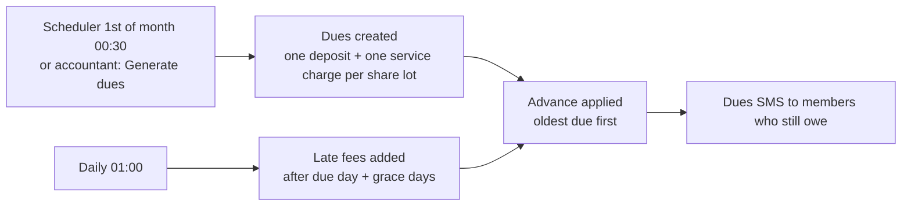
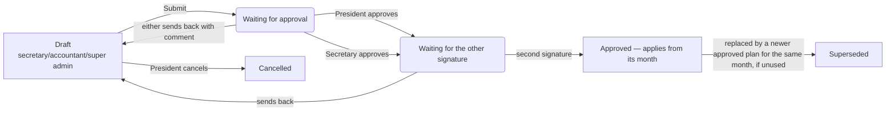
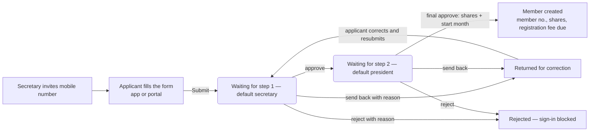
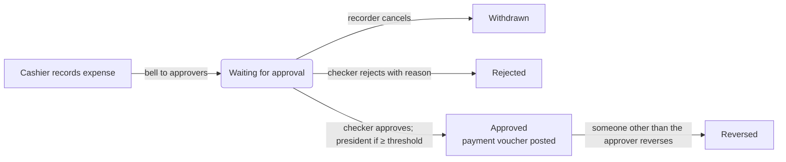
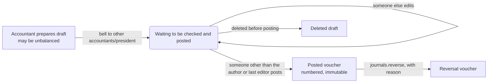
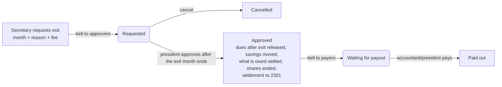
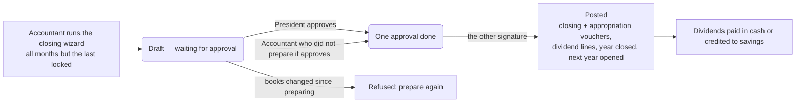

# Approval workflows

Every workflow below is taken from the code (`app/Domain/*/Actions`). Each step runs inside one database transaction that locks the rows it changes: either everything in a step happens, or nothing does. Bell messages are sent only after the transaction commits, so a failed step never announces anything. "Who" means "who the policy allows by default" — see `roles-and-permissions.md`.

Common to all money workflows:
- **Maker ≠ checker.** The person who enters something never approves it; the person who approves never reverses it.
- **Approved = recorded in the books.** Approving posts the journal voucher in the same transaction. There is no separate "posting" step that could fail afterwards.
- **Nothing is deleted.** Mistakes are corrected by rejection (before approval) or reversal (after approval), with a reason.
- **History.** Every record page has a **History** box: who entered it, who approved/rejected/reversed it and when, and — while it waits — the names of the people who can act now.
- **Double approval is impossible.** The record row is locked and its status re-checked; a second person acting at the same moment sees "already approved — refresh".

---

## 1. Payment (money received)

| | |
|---|---|
| Starts | Cashier/accountant/president on **Collections › Collect payment**, or the member on the portal / app (bKash or Nagad with TrxID) |
| Checks before saving | amount > 0, valid TrxID for bKash/Nagad and not used before, date not in future, member can pay; one idempotency key per submission (a double-click returns the same payment) |
| Approves | anyone with "approve payments" except the recorder (default: accountant, president) |
| On approval | RV voucher Dr Cash/Bank/bKash/Nagad, Cr savings 2101 / service 4111 / registration 4101 / late fee 4121; extra goes to advance 2111. Under the "lock prepaid months" policy, future months are created and paid at today's rate |
| On rejection | status only; nothing posted. Recorder gets a bell; the member gets an SMS and portal message with the reason |
| Reversal | needs "reverse payments", not the approver; reason required; posts a mirror voucher, undoes allocations and any advance applications that used this money |
| Where to track | Staff: Payments list and page (History). Member: portal **Receipts** / app payments, with the reason if rejected |
| Notifications | new → people who can approve; approved/rejected → recorder; reversed → recorder and approver; member → portal bell always, SMS on rejected/reversed (receipt SMS on approval) |

## 2. Dues, late fees and advance (automatic)

- Dues are generated month by month, never skipping a month, at most one month ahead. Each due copies the rate it was built from, so later rate changes never alter it.
- Nothing is posted when dues are created; income is recorded when a due is paid.
- Generating the same month twice creates nothing new (unique key per member, month and type).
- Late-fee waiver: accountant/president, open unpaid late fee only, reason required (single person — see known gaps).

## 3. Rate plan (prices)

- Needs both the president and the secretary, two different people, neither the drafter. If configured, a passed resolution must be linked.
- A plan may only start in a month that has no dues yet. **Retroactive corrections are switched off** until designed properly (decided 2026-10-11).
- On approval: under the "difference" registration-fee policy, top-up registration dues are created for existing shares.
- Notifications: submitted → president and secretary; approved/sent back → drafter.

## 4. Member self-registration

- The approval order is set on **Administration › Registration approvals**; registrations already submitted keep the order they were submitted with.
- Each person decides once per submission; nobody decides their own registration.
- Notifications: each step → everyone holding that role (bell with link); returned → applicant SMS + portal bell; rejected → SMS; approved → welcome SMS + portal bell.
- If no active user holds the role of the current step, the History box says so ("nobody can approve this right now").

## 5. Expense

- Approval checks the paying account holds enough money ("insufficient funds" otherwise).
- Expenses at or above the president threshold (default ৳10,000) need the president.
- Notifications: new → approvers; approved/rejected → recorder; reversed → recorder and approver.

## 6. Fund transfer (between cash, bank, bKash, Nagad)

Same shape as an expense: record → approve (contra voucher, any charge to 5104) or reject → reverse. The source must hold the amount plus charge; a reversal needs the destination to still hold it.

## 7. Manual voucher (journal draft)

- Posting checks balance, open period, open fiscal year, account rules; register accounts (advances 2111, dividends 2201, exits 2301, investments 13xx) cannot be used in a manual voucher.
- **Second person required** (decided 2026-10-11).

## 8. Investment

record → approve (president; resolution if configured; payment voucher to 13xx) or reject → while active: record income, write down, close. No reversal flow for an approved investment (known gap).

## 9. Member exit

- Approval refuses while the member has payments waiting for approval, owes more than they hold, or has a share change planned after the exit month.
- **Approving an exit ends all the member's shares from the next month; an exited member gets no dividend for that fiscal year or later** (decided 2026-10-11).

## 10. Year-end and dividends

- Recalculates on approval; if the books changed, approval is refused ("prepare it again").
- Dividends are shared by share-months with the largest-remainder method; members whose exit is approved are left out.

## 11. Meetings and resolutions

Meeting: draft/scheduled → held (attendance and quorum snapshot) or cancelled. Resolution: proposed → passed/rejected (only at a held meeting with quorum) or withdrawn. Resolutions can be required before approving rate plans, investments, year-ends and exits (`SOMITI_REQUIRE_RESOLUTION_FOR`).

## 12. Bank statement import

Import a CSV (same file twice is refused) → lines matched automatically to book entries → staff match, unmatch or ignore the rest. Reconciliation never changes the books.

## 13. Fiscal years and periods

Open the next fiscal year (no gaps; 12 monthly periods). Lock months as they are finished; a locked month accepts no postings. A year with income or expenses is closed only through the year-end.

---

## What happens when something goes wrong

| Situation | What the user sees | What happened |
|---|---|---|
| Someone else acted first | "This payment is already approved — someone has already dealt with it. Refresh…" | nothing saved |
| Two people at the same moment | "Someone else was changing the same record… nothing was saved. Refresh…" + reference | nothing saved |
| Permission removed meanwhile | "You do not have permission… Nothing was saved…" | nothing saved |
| Database safety rule refused | "The books refused this change, so nothing was saved…" + reference | nothing saved; logged |
| Unexpected server error | panel: "Refresh the page and check whether your change was saved before trying again" | logged with reference |

See `error-resolution-guide.md` for every message.
